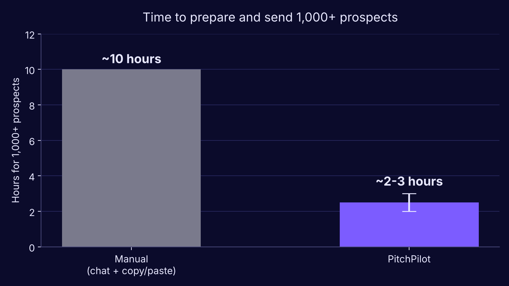

<div align="center">


# PitchPilot

**Personalized cold emails at scale. Verified, reviewed by you, sent safely. Bring your own model.**

[](LICENSE)
[](https://www.python.org/)
[](https://github.com/SmitPatel-07/PitchPilot/actions)
[](CONTRIBUTING.md)

Live demo (coming soon) · Video walkthrough (coming soon) · [Quickstart](#quickstart) · [Roadmap](#roadmap)

</div>

---

> **Status:** in active development. Demo GIF and live demo are coming soon.

<!-- Uncomment when the GIF is ready:

-->

## The problem

If you've done outbound, you know this loop. Open a chat with an AI model, paste a huge master prompt, tell it about the prospect, check the email address, copy the draft, send it, then start over for the next person.

It works. It's also slow, and the quality drops as the day goes on. The other option is a static template, and prospects can spot those from the first line.

PitchPilot automates the boring parts and keeps you in charge of the part that matters: deciding what actually gets sent.

## What it does

- **Imports your prospect list** from a CSV (Apollo exports work fine)
- **Verifies every email** before anything is written: syntax, MX records, disposable domains, role addresses like `info@`, plus an optional API check
- **Reads the prospect's website** and pulls out the facts worth mentioning
- **Writes a personalized email** from those facts, your offer and your own prompt
- **Puts every draft in an approval queue**, where you edit, approve or reject it
- **Sends only what you approved**, with daily caps and delays between emails
- **Logs replies and bounces** so you can see what's working
- **Works with any model** that has an OpenAI-compatible API

## How it works


CSV import → email verification → company research → AI draft → your review → send. Replies and bounces are logged after that.

Nothing gets sent without you approving it. That's on purpose.

<details>
<summary>Same flow as a text diagram</summary>


</details>

## Template vs PitchPilot


*Sample data, for illustration.*

**Static template**

> Hi Anna, I hope this email finds you well. We help companies like yours improve efficiency with innovative IT solutions. Would you be open to a quick call?

**PitchPilot draft**

> Hi Anna, saw that Brightline is hiring three backend engineers for the new tracking platform. Teams in that spot usually run into the same thing: the roadmap grows faster than the team. We help logistics companies add vetted engineers in weeks, not months. Worth a 15-minute chat next week?

The first one could go to anyone. The second one only makes sense for Anna.

## Results

From my own run on **1,000+ prospects**. This is one real run, not a controlled benchmark.

| | Manual (chat + copy/paste) | PitchPilot |
|---|---|---|
| Time for 1,000+ prospects | ~10 hours of constant work | ~2-3 hours, mostly automated |
| Time per prospect | ~36 seconds | ~7-11 seconds |
| Invalid emails caught before sending | n/a | 20-30 |



**Models tested so far:** the prompt worked well with GPT-4 (with web search) and Claude Sonnet 5. Free and local models (Groq, Gemini, Ollama) are supported through the same interface and are next on the testing list.

## Quickstart

You need Python 3.11+ and an API key for a model, or a local model (see [Pick your model](#pick-your-model)).

```bash
git clone https://github.com/SmitPatel-07/PitchPilot.git
cd PitchPilot
cp .env.example .env      # add your model settings
docker compose up
```

Open `http://localhost:8501`. A sample prospect list is included in `sample_data/` so you can try it right away.

No Docker? Run it directly:

```bash
python -m venv .venv && source .venv/bin/activate
pip install -r requirements.txt
streamlit run app.py
```

## Pick your model

PitchPilot talks to any model that has an OpenAI-compatible API. You change two or three lines in `.env`, no code changes.

| Option | Cost | Good for | `.env` settings |
|---|---|---|---|
| **Groq** | Free tier | Fast, good quality | `LLM_BASE_URL=https://api.groq.com/openai/v1`<br>`LLM_MODEL=openai/gpt-oss-120b` |
| **Gemini** | Free tier | Backup option | Use Google's OpenAI-compatible endpoint and a Flash model |
| **Ollama** | Free, runs locally | Privacy, works offline | `LLM_BASE_URL=http://localhost:11434/v1`<br>`LLM_API_KEY=ollama`<br>`LLM_MODEL=<model you pulled>` |

Free tiers have rate limits and they change over time, so check your provider's console. Free-tier terms also differ on how your data is used. If you're using real prospect data, read them first, or go with the local option.

## Your prompt, your voice

The writing instructions live in plain text in `prompts/system.md`. Edit it to match how you actually write: your offer, your tone, your rules. The default asks for:

- under 90 words
- one specific observation about the prospect
- no flattery, no buzzwords
- one clear, low-pressure ask

`prompts/example_master_prompt.md` is the full master prompt I used by hand before building this, so you can see where it started.

## Safe by default

- **Dry-run mode is on by default.** Emails are saved as `.eml` files instead of being sent, until you switch it off.
- **Human approval is required** for every email.
- **Daily send cap and delays** keep your domain reputation healthy.
- **Unsubscribe link and suppression list** are built in. Anyone who opts out is never contacted again.
- **Secrets stay in `.env`**, which is git-ignored.

> **A note on the law.** Cold email rules differ by country. GDPR applies in the EU, and Germany in particular has strict consent rules for marketing emails. PitchPilot gives you the tools to be careful, but it isn't legal advice, and you're responsible for how you use it. Check the rules for your target market first.

## Project structure

```
PitchPilot/
├── app.py                 # Streamlit app
├── src/
│   ├── ingest.py          # CSV import
│   ├── verify.py          # email checks
│   ├── scrape.py          # company website context
│   ├── generate.py        # model client + drafting
│   ├── send.py            # SMTP sending, limits, dry-run
│   └── store.py           # SQLite storage
├── prompts/
│   ├── system.md          # the writing prompt
│   └── example_master_prompt.md
├── sample_data/           # example prospects
├── docs/                  # architecture notes and images
├── tests/
├── .env.example
├── docker-compose.yml
└── LICENSE
```

## Roadmap

**v0.1**
- [ ] CSV import
- [ ] Email verification
- [ ] Website scraping
- [ ] Draft generation with swappable models
- [ ] Approval queue
- [ ] Sending with dry-run and limits
- [ ] Unsubscribe and suppression list

**Next**
- [ ] Follow-up sequences
- [ ] Reply detection and tagging
- [ ] Account research brief (company domain in, one-page brief out)
- [ ] CRM export (HubSpot, Pipedrive)
- [ ] Multi-language drafts, including German

Have an idea? [Open an issue](../../issues). Look for the `good first issue` label if you want to contribute.

## Why I built this

I started in sales with templates. Change the first name, change the company name, hit send. After about 1,000 emails I'd get one or two replies, and not even meetings. Almost everyone does this when they start.

Then I got better. I began researching each prospect by hand, reading their LinkedIn and their company site, and writing emails that actually sounded like they were meant for that person. That worked, but it took forever.

Then AI arrived and I used it to speed things up. I wrote master prompts and switched between different models depending on the job. Faster, but still the same loop: paste, check, copy, send, repeat. After 3+ years in outbound, I've done some version of that loop more times than I can count.

PitchPilot is the next step. It automates the whole loop, and it keeps a human making the final call.

## Contributing

Pull requests are welcome. Read [CONTRIBUTING.md](CONTRIBUTING.md) first. If it's a big change, open an issue so we can talk about it.

## License

[MIT](LICENSE)

## Author

Built by **Smit**. I'm moving to Germany and building sales tools along the way.
[LinkedIn](https://www.linkedin.com/in/mrpatelsmit) · [GitHub](https://github.com/SmitPatel-07)
